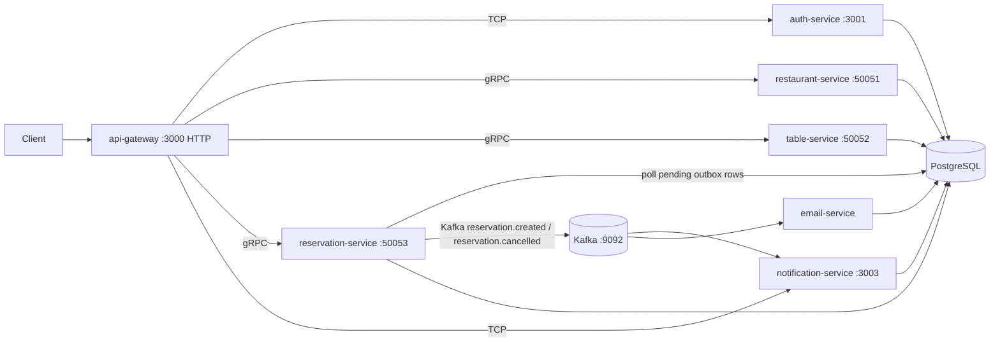

# Restaurant Table Reservation — Project Context

NestJS 12 ESM monorepo. HTTP API gateway fronts auth (TCP), restaurant/table/reservation (gRPC), and notifications (TCP). Reservation create/cancel writes events to a PostgreSQL transactional outbox; a publisher polls the outbox and publishes to Kafka for notification-service and email-service consumers.

## Architecture



| App | Transport | Default port |
| --- | --- | --- |
| `apps/api-gateway` | HTTP + TCP/gRPC clients | 3000 |
| `apps/auth-service` | TCP | 3001 |
| `apps/restaurant-service` | gRPC `restaurant.RestaurantService` | 50051 |
| `apps/table-service` | gRPC `table.TableService` | 50052 |
| `apps/reservation-service` | gRPC `reservation.ReservationService` + Kafka producer | 50053 |
| `apps/notification-service` | TCP + Kafka consumer | 3003 |
| `apps/email-service` | Kafka consumer only | — |

| Library | Alias |
| --- | --- |
| `libs/common` | `@app/common` |
| `libs/database` | `@app/database` |
| `libs/kafka` | `@app/kafka` |
| `libs/redis` | `@app/redis` |
| `libs/loki` | `@app/loki` |

Canonical proto files: `libs/common/src/proto/*.proto`. Kafka topics: `reservation.created`, `reservation.cancelled` (`KAFKA_TOPICS`). Failed consumer events are retried with backoff and then written to `<source-topic>.dlq` by the Kafka retry interceptor. See [DLQ_OPERATIONS.md](DLQ_OPERATIONS.md).

## Infrastructure and observability

`docker-compose.yml` provides PostgreSQL (:5432), Kafka (:9092), Redis (:6379), Loki (:3100), Grafana (:3005), Prometheus (:9090), Tempo, the OpenTelemetry Collector (OTLP :4317/:4318), and Redpanda Console (:8080). Service processes normally run on the host using `npm run start:dev`.

Rate limiting uses `@nestjs/throttler` with a custom Redis-backed storage adapter; request counts are shared across gateway instances. Redis also backs idempotency and DLQ replay state. The gateway default is 100 requests/minute per throttler key, with route overrides. See `apps/api-gateway/src/rate-limit/`.

OpenTelemetry metrics flow through the collector to Prometheus; traces flow through the collector to Tempo; logs flow to Loki. Grafana is provisioned with Kafka and DLQ Operations, Service Health Overview, and OpenTelemetry Signals Overview dashboards. See [OBSERVABILITY_OPERATIONS.md](OBSERVABILITY_OPERATIONS.md) for access and troubleshooting.

## How to run

```bash
cp .env.example .env          # edit JWT_SECRET before sharing/exposing the app
set -a; source .env; set +a   # load values in this shell (dotenv is not auto-loaded)
docker compose up -d          # postgres, kafka, redis, and observability stack
npm run db:push
npm run start:dev             # starts all Nest services with OpenTelemetry enabled
```

Copy `.env.example` as a reference, then load its values into the shell that starts the services. Relevant variables include `DATABASE_URL`, `JWT_SECRET`, `ADMIN_EMAILS`, `REDIS_URL`, `KAFKA_BROKER` or `KAFKA_BROKERS`, `KAFKA_RETRY_*`, `KAFKA_DLQ_SUFFIX`, `LOKI_URL`, `LOKI_ENABLED`, `OTEL_EXPORTER_OTLP_ENDPOINT`, `OTEL_SDK_DISABLED`, and `CORS_ORIGINS`. Do not globally set `PORT` when starting all services together: every process would inherit the same port.

Email service writes rows to `email_logs` and logs to stdout (no SMTP yet). Notification rows go to `notifications`.

## Gateway HTTP API

JWT: `Authorization: Bearer`. Mutations generally require JWT.

Auth: `POST /auth/register`, `POST /auth/login`, `GET /auth/profile`, `POST /auth/validate`.

Restaurants: CRUD `/restaurants`, plus `/restaurants/:id/location`, `/opening-hours`, `/house-rules`.

Floors/tables: `GET|POST /restaurants/:id/floors`, `GET|PUT|DELETE /floors/:floorId`, `GET|POST /restaurants/:id/tables`, `GET|PUT|DELETE /tables/:tableId`, `GET|POST /floors/:floorId/combinations`, `DELETE /combinations/:id`.

Reservations: `POST /reservations` (body `CreateReservationDto`), `GET /reservations`, `GET /reservations/:id`, `POST /reservations/:id/cancel`.

Notifications: `GET /notifications`.

## Domain rules

- No FK from restaurant/table/reservation owner/user ids onto `users`.
- Floors unique per `(restaurantId, floorNumber)`. Tables unique per `(floorId, tableNumber)`. Capacity > 0.
- Reservation create checks table exists, same restaurant, partySize ≤ capacity, no overlapping non-cancelled booking on that table.
- Cancel is allowed only for the reserving `userId` when one is set.
- Reservation events are committed to `outbox_events` in the same database transaction as the reservation mutation. The outbox publisher polls pending rows, leases them, publishes to Kafka, and retries failures with backoff. Delivery is at least once, so consumers must remain idempotent.

## Conventions

- ESM, `.js` import extensions, `@app/*` path aliases.
- gRPC clients: inject `ClientGrpc`, then `getService()` in `onModuleInit`. RPC names match proto (PascalCase in `@GrpcMethod`, camelCase on the client).
- Nest Kafka consumers use `@EventPattern` with the topic string; producer payload is `{ pattern, data }`.
- Read the repository-root `AGENTS.md` for agent development and verification guidance. `.env.example` contains placeholders only; never commit `.env` or real secrets.
